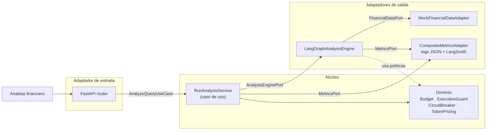
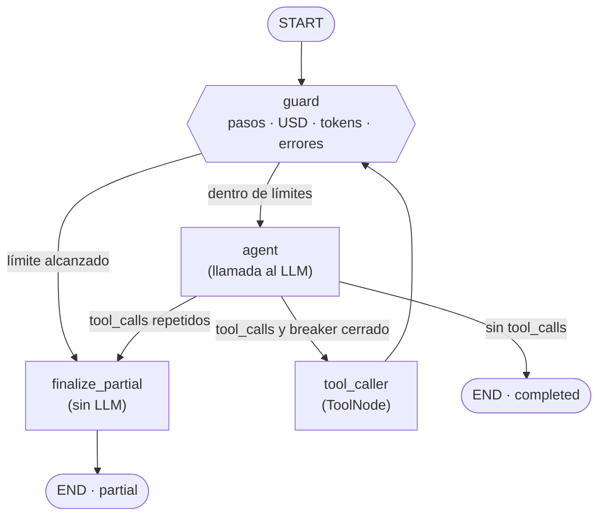

# CLAUDE.md — Agente de Análisis Financiero (FinOps-aware)

## Propósito
Agente de IA que asiste a analistas financieros del banco en la evaluación de indicadores clave,
ratios y tendencias sobre múltiples periodos. Reemplaza una versión en producción que consumía
cientos de miles de tokens por consulta (hasta $200/sesión) sin registrar métricas.
**Objetivo central: respuestas útiles con costo acotado, ejecución acotada y trazabilidad total.**

## Alcance (estricto)
Implementar SOLO lo siguiente. No agregar funcionalidades, herramientas, capas ni dependencias
que no estén listadas aquí. Si algo parece necesario y no está, preguntar antes de implementarlo.

Dentro de alcance:
- Endpoint `POST /api/v1/analysis/query`
- Grafo LangGraph: `guard` → `agent` ↔ `tool_caller`, con salidas `END` (completed) y `finalize_partial` (partial)
- 2 herramientas mockeadas: `search_financial_data`, `calculate_ratio`
- Límites: pasos, tokens, presupuesto USD, timeout global, rate limiter
- Circuit breaker para bucles
- Métricas por paso en LangSmith + logs estructurados FinOps
- Respuesta parcial con advertencia cuando se agota un límite

Fuera de alcance: autenticación, base de datos, UI, APIs financieras reales, memoria de
conversación entre requests, herramientas adicionales, colas, caché.

## Stack
- Python 3.13+, FastAPI, Pydantic v2, pydantic-settings
- LangGraph (`StateGraph`, `ToolNode`, checkpointer en memoria)
- LangChain (chat model con `rate_limiter`, `@tool`)
- LangSmith (tracing nativo vía variables de entorno)
- pytest + httpx para pruebas

## Arquitectura: hexagonal (puertos y adaptadores)
El desarrollo sigue arquitectura hexagonal. **Leer `docs/ARCHITECTURE.md` antes de crear o mover
módulos**; contiene los diagramas completos y la justificación de cada decisión.

Regla de dependencias (obligatoria):
- `domain/` no importa nada del proyecto ni frameworks: ni FastAPI, ni LangChain, ni LangGraph, ni Pydantic.
- `application/` importa solo `domain/`. Define los puertos (`Protocol`) y los casos de uso.
- `adapters/` importa `application/` y `domain/`. Es el ÚNICO lugar donde aparecen FastAPI, LangChain, LangGraph y LangSmith.
- `config/container.py` es el único lugar que instancia adaptadores y los inyecta en los casos de uso.



### Flujo del grafo


Reglas del flujo:
- `guard` se ejecuta antes de CADA llamada al LLM. Ninguna ruta llega a `agent` sin pasar por `guard`.
- `guard` y `route_after_agent` solo leen el estado y delegan la decisión en `domain/policies.py`.
- `finalize_partial` arma la respuesta a partir de los resultados de tools ya obtenidos, sin llamar al LLM.
- Orden de evaluación en `guard`: errores consecutivos → presupuesto USD → tokens → pasos.

## Estructura del proyecto
```
app/
  domain/
    models.py            # Budget, StepMetric, AnalysisResult, ExecutionLimits, StopReason (dataclasses/enum)
    policies.py          # ExecutionGuard, CircuitBreaker
    pricing.py           # TokenPricing: costo a partir de tokens de entrada/salida
    ratio.py             # cálculo puro de ratio (usado por la tool calculate_ratio)
  application/
    ports/
      inbound.py         # AnalyzeQueryUseCase (Protocol)
      outbound.py        # AnalysisEnginePort, FinancialDataPort, MetricsPort (Protocol)
    services/
      run_analysis.py    # RunAnalysisService: implementa AnalyzeQueryUseCase
  adapters/
    inbound/http/
      router.py          # POST /api/v1/analysis/query
      schemas.py         # modelos Pydantic de request/response y mapeo a dominio
    outbound/
      agent/
        engine.py        # LangGraphAnalysisEngine: implementa AnalysisEnginePort; timeout y recuperación de estado
        graph.py         # construcción y compilación del StateGraph
        state.py         # AgentState (TypedDict)
        nodes.py         # guard, agent, finalize_partial
        routing.py       # route_after_guard, route_after_agent
        tools.py         # @tool search_financial_data, calculate_ratio (delegan en puertos/dominio)
      data/
        mock_financial_data.py   # implementa FinancialDataPort
      metrics/
        json_logger.py           # implementa MetricsPort
        langsmith_metrics.py     # implementa MetricsPort
        composite.py             # reenvía a ambos; si LangSmith falla, el log JSON se mantiene
  config/
    settings.py          # Settings (pydantic-settings)
    container.py         # wiring de dependencias
  main.py                # crea la app FastAPI y llama al container
tests/
  unit/                  # dominio y casos de uso, con dobles de los puertos
  integration/           # grafo con chat model falso
  api/                   # endpoint con httpx
```

## Contrato de la API
Request:
```json
{"analyst_id": "A01", "session_id": "S001", "query": "texto", "max_budget_usd": 0.50}
```
Validaciones: todos obligatorios; `query` no vacío; `max_budget_usd > 0`.

Response (HTTP 200 siempre que el agente se haya ejecutado, aunque sea parcial):
```json
{
  "status": "completed | partial",
  "answer": "texto",
  "warning": "null | mensaje de límite alcanzado",
  "stop_reason": "completed | budget_exceeded | token_budget_exceeded | max_steps_reached | timeout | loop_detected | tool_errors",
  "budget": {"max_budget_usd": 0.5, "spent_usd": 0.0, "remaining_usd": 0.0,
             "max_tokens": 10000, "tokens_used": 0, "remaining_tokens": 0},
  "steps": [StepMetric],
  "elapsed_time_s": 0.0
}
```
HTTP 422 solo para requests inválidos. Ningún límite alcanzado produce un 5xx.

## Límites (valores en `config/settings.py`, sobreescribibles por env)
| Límite | Valor | Dónde se aplica |
|---|---|---|
| `MAX_STEPS` | 8 | `ExecutionGuard`, vía nodo `guard` |
| `recursion_limit` | `3 * MAX_STEPS + 3` | Red de seguridad nativa de LangGraph (`GraphRecursionError`) |
| `MAX_TOKENS_BUDGET` | 10000 | `Budget`, con tokens de `AIMessage.usage_metadata` |
| `max_budget_usd` | del request | `Budget` + `TokenPricing` |
| `TIMEOUT_GLOBAL_S` | 45 | `asyncio.wait_for` en `LangGraphAnalysisEngine` |
| Rate limiter | `RATE_LIMIT_RPS` | `InMemoryRateLimiter` pasado al chat model |

Reglas:
- Un **paso** = una ejecución del nodo `agent` (una llamada al LLM) más las tools que esa llamada dispare.
- Se detiene con el **primer** límite que se alcance (USD o tokens, lo que ocurra antes).
- `guard` estima el costo de la siguiente llamada; si el restante no alcanza, no se llama al LLM.
- `max_tokens` de cada llamada al LLM se acota al presupuesto de tokens restante.
- El control principal es el estado del grafo. `GraphRecursionError` y `asyncio.TimeoutError` son respaldo.
- Ante esas excepciones, el engine recupera el último estado con `graph.get_state(config)` y devuelve respuesta parcial.
- `thread_id` del checkpointer = `f"{session_id}:{request_id}"`, para que los requests de una misma sesión no compartan estado.

## Circuit breaker (`domain/policies.py`)
- Firma de llamada = `(tool_name, args normalizados)`.
- Si la misma firma se repite `CB_MAX_REPEATS` veces (default 2) → `loop_detected`; la tool no se ejecuta.
- `CB_MAX_CONSECUTIVE_ERRORS` errores de tool consecutivos (default 3) → `tool_errors`.
- El estado del breaker vive en `AgentState` y dura un solo request.

## Herramientas (mocks — no conectar a nada real)
- `search_financial_data(metric: str, period: str) -> dict`
  - La tool LangChain delega en `FinancialDataPort`; el adaptador es `MockFinancialDataAdapter`
  - `await asyncio.sleep(2)` (async; nunca `time.sleep`, para no bloquear el event loop)
  - Datos deterministas desde un diccionario en memoria
  - Métrica o periodo desconocido → `{"error": "..."}` (sin lanzar excepción)
- `calculate_ratio(numerator: float, denominator: float) -> dict`
  - La tool delega en `domain/ratio.py`
  - Retorna `{"result": numerator / denominator}`; `denominator == 0` → `{"error": "division by zero"}`
- Las tools no consumen tokens: costo 0; su latencia queda en `elapsed_time`.

## Métricas FinOps
`StepMetric` (dominio) por cada paso:
```
step_number, tool_called (lista o null), tokens_used, cumulative_tokens,
step_cost_usd, cumulative_cost, remaining_budget_usd, elapsed_time
```
- `tokens_used` sale exclusivamente de `AIMessage.usage_metadata` (input + output). La estimación previa solo se usa en `guard`.
- Costo = `input_tokens * PRICE_INPUT_PER_MTOK / 1e6 + output_tokens * PRICE_OUTPUT_PER_MTOK / 1e6`, calculado por `TokenPricing`.
- Se emite mediante `MetricsPort`; nunca se llama a `logging` ni a LangSmith directamente desde nodos o dominio.
  1. LangSmith: tracing nativo (`LANGSMITH_TRACING=true`); `analyst_id`, `session_id` y `request_id` van como `metadata` y `tags` en el `config` del invoke.
  2. Logs JSON a stdout: un evento `analysis_step` por paso y un evento `analysis_completed` final.
- Si LangSmith no está disponible, el agente sigue funcionando y el log JSON se mantiene.

## Variables de entorno
```
LLM_MODEL=
LLM_API_KEY=
PRICE_INPUT_PER_MTOK=
PRICE_OUTPUT_PER_MTOK=
LANGSMITH_TRACING=true
LANGSMITH_API_KEY=
LANGSMITH_PROJECT=financial-analysis-agent
MAX_STEPS=8
MAX_TOKENS_BUDGET=10000
TIMEOUT_GLOBAL_S=45
RATE_LIMIT_RPS=
CB_MAX_REPEATS=2
CB_MAX_CONSECUTIVE_ERRORS=3
```

## Comandos
```
pip install -r requirements.txt
uvicorn app.main:app --reload
pytest -q
```

## Pruebas obligatorias
- `tests/unit`: dominio sin frameworks (Budget, ExecutionGuard, CircuitBreaker, TokenPricing, ratio) y `RunAnalysisService` con dobles de los puertos.
- `tests/integration`: grafo con chat model falso y determinista (sin llamadas reales ni costo).
- `tests/api`: endpoint con httpx.

Escenarios mínimos:
- Consulta que termina normal → `completed`
- Misma tool con mismos args repetida → `loop_detected`
- Presupuesto USD muy bajo (ej. 0.0001) → `budget_exceeded` con respuesta parcial
- Más de 8 pasos → `max_steps_reached`
- Timeout (con timeout reducido en test) → `timeout`
- `calculate_ratio` con denominador 0
- Cada respuesta incluye `steps` con todos los campos de `StepMetric`

## Convenciones
- Todo async de punta a punta.
- Tipado completo. Dominio con `dataclasses`; Pydantic solo en adaptadores y config; `TypedDict` para el estado del grafo.
- Puertos como `typing.Protocol`.
- Mensajes al analista en español.
- No capturar excepciones genéricas sin registrarlas con su `stop_reason`.
- Ninguna ruta de código puede invocar al LLM sin pasar antes por `guard`.