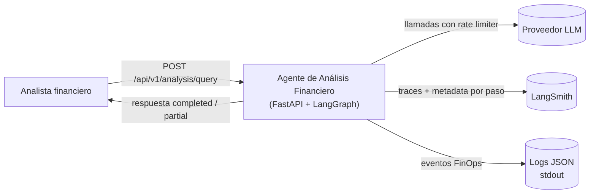
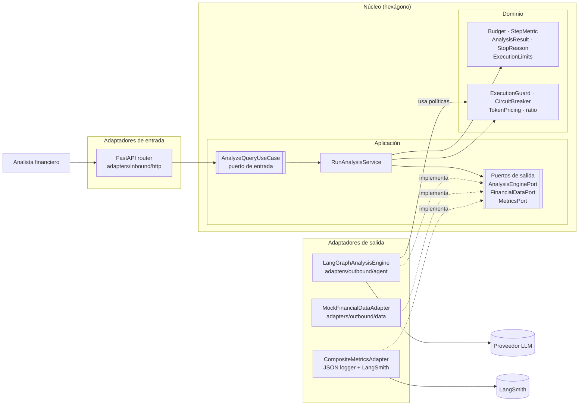
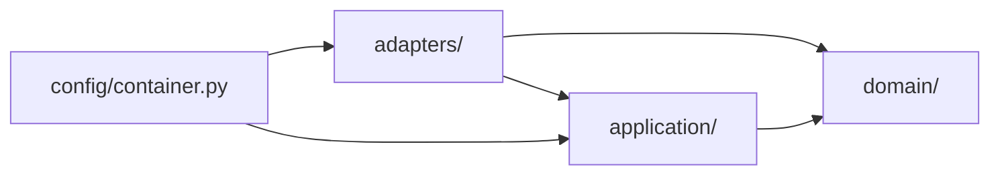
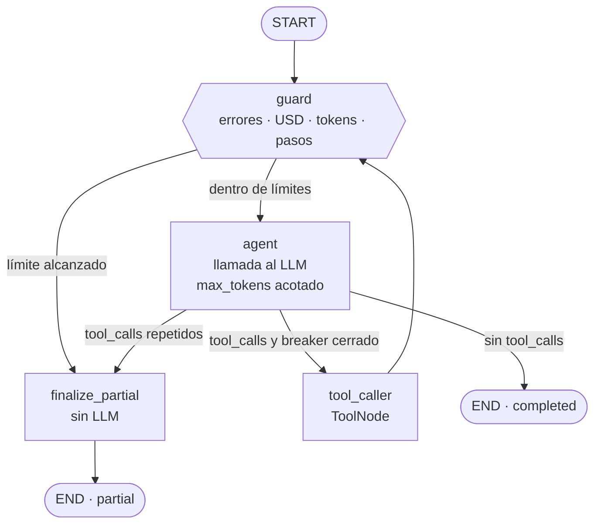
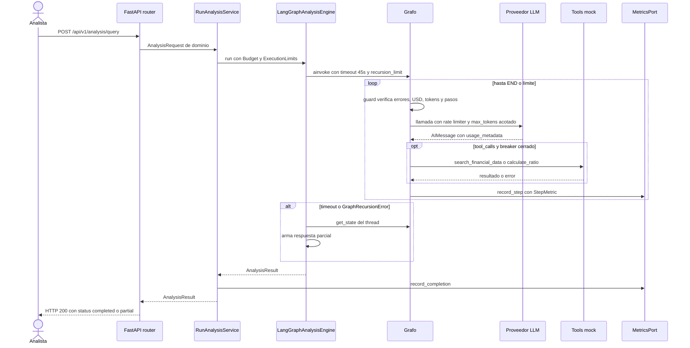

# Arquitectura — Agente de Análisis Financiero

Este documento describe la arquitectura del agente de análisis financiero y explica por qué se diseñó así.

> **Estado de implementación:** el presupuesto es por request. El acumulado por sesión
> (`SessionBudgetRepositoryPort`, HTTP 409, `overshoot_*`) está diferido (ADR-0001/0003/0004/0010).
> El código vive en `src/agentefinanciero/`; las rutas `app/...` de los diagramas se leen con ese prefijo.
Parte del borrador inicial y lo convierte en un diseño hexagonal que controla costo, pasos y tiempo
desde el núcleo de la aplicación.

## 1. Punto de partida: el borrador

El borrador original representaba correctamente el núcleo del agente. Su ciclo `agent → tool_caller → agent`,
con aristas punteadas hacia `tool_caller` y `END`, sigue la convención de LangGraph: las líneas punteadas son
aristas condicionales (el LLM decide) y la línea sólida de `tool_caller` hacia `agent` es una arista fija.
Ese patrón ReAct es justo el que, sin controles, produjo el incidente de $200 por sesión, porque el único
camino hacia `END` dependía de que el modelo decidiera terminar.

El borrador no reflejaba los requisitos que motivan el proyecto:

| Elemento del borrador | Ajuste en la arquitectura curada |
|---|---|
| Única salida a `END`, decidida por el LLM | Dos salidas: `completed` (el LLM terminó) y `partial` (un límite cortó la ejecución) |
| `tool_caller` vuelve directo a `agent` | `tool_caller` vuelve a `guard`, que verifica límites antes de cada llamada al LLM |
| Sin nodo de control de presupuesto | Nodo `guard` que delega en políticas de dominio |
| Sin `START` ni capa HTTP | `START` explícito y adaptador FastAPI como entrada |
| Config `rate_limit/timeout` sin conexión | Rate limiter en el chat model; timeout global en el engine |
| LangSmith conectado al "Agente IA" en general | Métricas por paso a través de un puerto, con dos destinos: LangSmith y logs JSON |
| Tools colgando del grafo | Tools como adaptadores; los datos simulados detrás de `FinancialDataPort` |

## 2. Vista de contexto

El sistema tiene una sola entrada, el endpoint HTTP, y tres dependencias externas: el proveedor LLM,
LangSmith y la salida de logs. Los datos financieros no son una dependencia externa porque están
simulados dentro del sistema.

## 3. Vista hexagonal

### 3.1 Capas y responsabilidades

**Dominio.** Contiene las reglas que hacen de este agente un agente FinOps. `Budget` lleva la cuenta del
gasto en USD y en tokens, y sabe responder si puede pagar una llamada más. `ExecutionGuard` combina todos
los límites (pasos, USD, tokens, errores) y devuelve el motivo de corte, si lo hay. `CircuitBreaker`
detecta llamadas repetidas a una tool y errores consecutivos. `TokenPricing` convierte tokens en dinero.
`ratio` es el cálculo puro que usa la tool `calculate_ratio`. Nada de esto importa frameworks, así que se
prueba con tests unitarios simples y no depende de que LangGraph cambie de versión.

**Aplicación.** Define qué hace el sistema sin decir cómo. `RunAnalysisService` recibe la consulta, arma el
`Budget` inicial a partir de `max_budget_usd` y de los límites configurados, invoca al motor mediante
`AnalysisEnginePort` y registra el cierre mediante `MetricsPort`. Los puertos son `Protocol` de Python.

**Adaptadores de entrada.** El router FastAPI valida el request con Pydantic, lo traduce a objetos de
dominio, llama al caso de uso y traduce el `AnalysisResult` a la respuesta JSON.

**Adaptadores de salida.** `LangGraphAnalysisEngine` es la pieza más grande. Implementa `AnalysisEnginePort`
y concentra todo lo específico de LangGraph y LangChain: el grafo, el estado, el checkpointer, el rate
limiter, el timeout global y la recuperación de estado ante excepciones. `MockFinancialDataAdapter`
implementa `FinancialDataPort` con datos deterministas y un retraso de 2 segundos. `CompositeMetricsAdapter`
reenvía cada métrica al logger JSON y a LangSmith; si LangSmith falla, el log local se mantiene.

### 3.2 Regla de dependencias

Las flechas indican qué paquete puede importar a cuál. El dominio no importa nada. Esto es lo que permite
que las reglas de presupuesto se prueben de forma aislada y que el motor LangGraph se pueda reemplazar sin
tocar esas reglas.

### 3.3 Por qué LangGraph es un adaptador y no el núcleo

LangGraph orquesta, pero las decisiones de negocio (cuánto se puede gastar, cuándo cortar, qué cuenta como
bucle) no le pertenecen. Por eso los nodos `guard` y la función de ruteo son delgados: leen el estado del
grafo, construyen los objetos de dominio y le preguntan a `ExecutionGuard` o `CircuitBreaker` qué hacer.
Si mañana el motor fuera otro, las políticas se mantienen intactas.

## 4. Flujo del grafo

**`guard`** se ejecuta antes de cada llamada al LLM. Evalúa, en orden: errores consecutivos de tools,
presupuesto USD, presupuesto de tokens y número de pasos. Además estima el costo de la siguiente llamada:
si el restante no alcanza, corta antes de gastar. Esto cambia el límite de blando (se detecta cuando ya se
excedió) a duro (no se excede).

**`agent`** llama al LLM con el rate limiter configurado y con `max_tokens` acotado al presupuesto de tokens
restante. Al recibir la respuesta, lee `usage_metadata`, calcula el costo con `TokenPricing` y actualiza el
`Budget` en el estado.

**`route_after_agent`** decide el siguiente nodo leyendo el estado. El nodo `agent` ya registró las llamadas
pedidas en el `CircuitBreaker` (una arista condicional no puede modificar el estado) y, si la firma
`(tool, args)` alcanzó el máximo permitido, dejó `stop_reason = loop_detected`: el flujo va a
`finalize_partial` sin ejecutar la tool. Así se corta el bucle antes de pagar otra vuelta.

**`tool_caller`** ejecuta las tools (envolviendo a `ToolNode`), registra en el breaker si cada resultado fue
un error y vuelve a `guard`, no a `agent`. El `StepMetric` se emite en el nodo `agent`, al recibir la
respuesta del LLM; su `elapsed_time` es acumulado desde el inicio del request, así que la latencia de las
tools de un paso aparece en el `elapsed_time` del siguiente.

**`finalize_partial`** arma la respuesta parcial con los datos que las tools ya devolvieron y la advertencia
del motivo de corte. No llama al LLM, porque si el presupuesto se agotó no debería gastarse más para
redactar la respuesta.

### 4.1 Mecanismos nativos como red de seguridad

| Mecanismo | Rol |
|---|---|
| `recursion_limit = 3 * MAX_STEPS + 3` | Respaldo si `guard` fallara. Cada paso usa hasta 3 supersteps (`guard`, `agent`, `tool_caller`) |
| `asyncio.wait_for(..., 45)` | Timeout global, aplicado en el engine alrededor de `graph.ainvoke` |
| `InMemoryRateLimiter` | Frecuencia de llamadas al proveedor LLM |
| Checkpointer en memoria | Permite recuperar el último estado con `get_state` tras un timeout o `GraphRecursionError` |

El control principal está en el estado del grafo porque una excepción interrumpe la ejecución y, sin
checkpointer, se pierde lo acumulado. Con el checkpointer, incluso un timeout produce una respuesta parcial
con los datos obtenidos hasta ese momento. El `thread_id` combina `session_id` y un `request_id` propio de
cada request, para que dos consultas de la misma sesión no compartan estado.

## 5. Secuencia de una consulta

## 6. Observabilidad FinOps

Cada paso produce un `StepMetric` con `step_number`, `tool_called`, `tokens_used`, `cumulative_tokens`,
`step_cost_usd`, `cumulative_cost`, `remaining_budget_usd` y `elapsed_time`. El dominio lo construye y
`MetricsPort` lo emite; ningún nodo llama a `logging` ni a LangSmith directamente.

En LangSmith, el tracing nativo de LangGraph registra cada nodo, llamada al LLM y llamada a tool. El engine
agrega `analyst_id`, `session_id` y `request_id` como `metadata` y `tags`, de modo que se puede filtrar el
gasto por analista o por sesión. En paralelo, los logs JSON a stdout (`analysis_step` y
`analysis_completed`) garantizan que las métricas existan aunque LangSmith no esté disponible. Es
precisamente lo que faltaba en la versión en producción.

## 7. Cómo responde cada falla del sistema anterior

| Falla en producción | Respuesta de la arquitectura |
|---|---|
| Cientos de miles de tokens por consulta | `Budget` con tope en USD y en tokens, verificado antes de cada llamada |
| Sesiones de hasta $200 | Tope por request; `max_tokens` acotado al restante |
| Consultas que no llegaban a respuesta útil | Respuesta parcial con los datos ya obtenidos en vez de seguir gastando |
| Bucles de herramientas | `CircuitBreaker` por firma de llamada y por errores consecutivos |
| Sin métricas de ejecución, tokens ni tools | `StepMetric` por paso, emitido a LangSmith y a logs JSON |
| Ejecuciones sin límite de tiempo | Timeout global de 45 s con recuperación de estado |
